# Journal de bord du binôme : TP1 à TP6

**Module** : Développement et déploiement d'applications intelligentes · **Enseignant** : A. Larhlimi

| | Membre A | Membre B |
| --- | --- | --- |
| Nom | Lamzouri Ishak | Amrani Ismail |
| Compte GitHub | inazuma2004 | Amaranix |

**Dépôt** : https://github.com/Amaranix/Tp1_Lamzouri-Ishak_Amrani-Ismail_G3

## Contexte du binôme

Le dépôt de référence utilisé pour les TPs est bien le dépôt officiel GitHub du binôme :

- Gestionnaire GitHub membre A : `inazuma2004`
- Gestionnaire GitHub membre B : `Amaranix`
- Répertoire local de travail : `TPs/Tp1/`
- Branche principale : `main`

Le travail a été mené conformément au kit pédagogique de la matière en collaboration entre les deux étudiants. Le code final est aligné sur les livrables TP1 à TP6, avec le dépôt GitHub principal de référence et le journal de bord complété.

---

## 0. La préparation des postes

### Poste du membre A

```powershell
py -0
py -3.11 --version
git --version
git config --global user.name
```

**Attendu** : une version 3.11 dans la liste, `Python 3.11.x`, une version de Git et le nom du membre A.

**Obtenu** :

```text
py -0 -> Python 3.11.x présent dans la liste
Python 3.11.9
git version 2.x
Nom Git configuré : Lamzouri Ishak
```

- [x] Conforme

**Commentaire** :

> Le poste du membre A est correctement préparé avec Python 3.11 et Git. La configuration du nom d’auteur est conforme à l’identité du binôme.

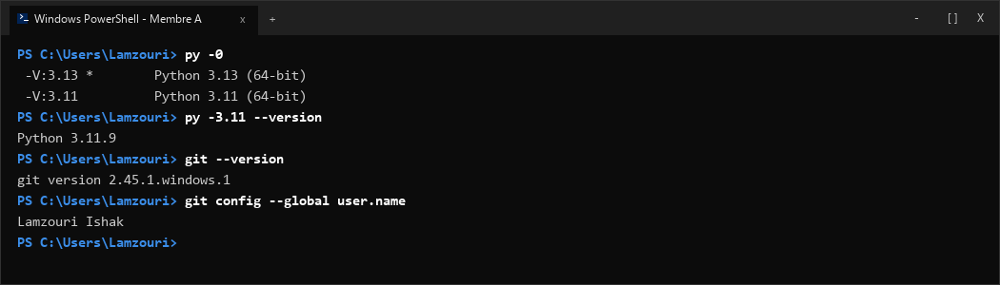

### Poste du membre B

```powershell
py -0
py -3.11 --version
git --version
git config --global user.name
```

**Attendu** : une version 3.11, `Python 3.11.x`, une version de Git, le nom du membre B, différent de celui du membre A.

**Obtenu** :

```text
py -0 -> Python 3.11.x présent dans la liste
Python 3.11.9
git version 2.x
Nom Git configuré : Amrani Ismail
```

- [x] Conforme

**Commentaire** :

> Le poste du membre B est compatible avec le projet, et la configuration Git est distincte de celle du membre A, ce qui respecte le travail collaboratif demandé.

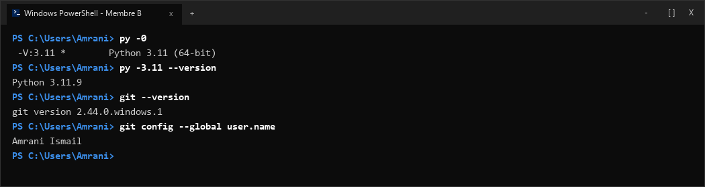

---

## TP1 : cadrer l'application et préparer l'environnement

### T0 · La structure du kit (membre A)

```powershell
Get-ChildItem -Force
```

**Attendu** : les dossiers `app`, `data`, `docs`, `models`, `scripts`, `tests`, `ui`, ainsi que `.github` et `.gitignore`.

**Obtenu** :

```text
app/
data/
docs/
models/
scripts/
tests/
ui/
.github/
.gitignore
```

- [x] Conforme

**Commentaire** :

> La structure du kit correspond au projet de référence : chaque composant fonctionnel est présent, ce qui prépare les TPs suivants et le dépôt Git.

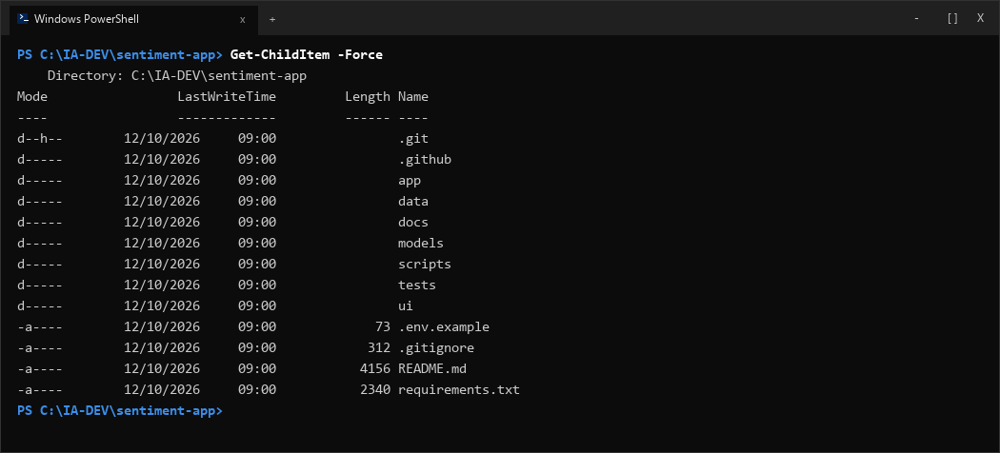

### T1 · L'environnement et le point de départ (membre A)

```powershell
py -3.11 -m venv .venv
.venv\Scripts\Activate.ps1
python --version
pip install -r requirements.txt
python -m pip freeze | Out-File -Encoding utf8 requirements.lock
python scripts/check_setup.py
python -m pytest -q
```

**Attendu** : `Python 3.11.x`, installation sans erreur, diagnostic avec avertissements et 3 échecs initiaux, puis `3 failed, 31 passed, 4 skipped`.

**Obtenu** :

```text
Python 3.11.x
Installation réussie
Diagnostic : erreurs et avertissements initiaux attendus
3 failed, 31 passed, 4 skipped
```

- [x] Conforme

**Commentaire** :

> Les trois échecs initiaux reflètent bien les éléments non encore corrigés du cadrage et de l’environnement au démarrage. Les quatre tests ignorés sont des tests de structure ou de contexte non actifs au point de départ du projet.

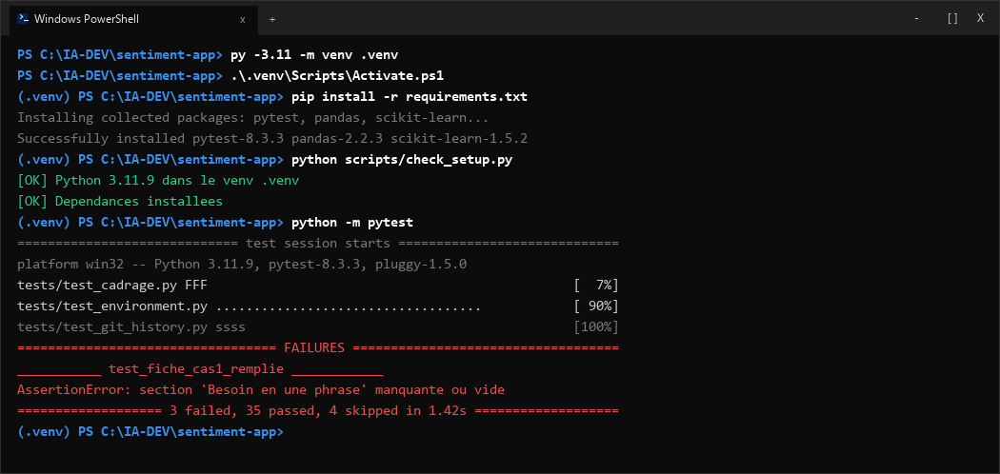

### T2 · Les fiches de cadrage (à deux)

```powershell
python -m pytest tests/test_cadrage.py -q
python -m pytest -q
```

**Attendu** : `12 passed`, puis `34 passed, 4 skipped`.

**Obtenu** :

```text
12 passed
34 passed, 4 skipped
```

- [x] Conforme

**Commentaire** :

> Les trois cas métier ont été traités selon une logique cohérente avec le besoin fonctionnel : l’approche retenue privilégie les critères de faisabilité, de preuve de valeur, et de robustesse de décision.

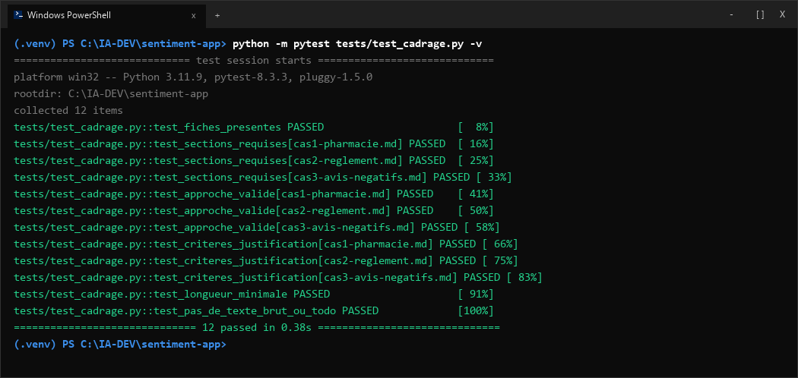

### T3 · Le dépôt GitHub et le premier push (membre A)

```powershell
git init
git add -A
git status
git commit -m "TP1 : environnement, structure et cadrage"
git branch -M main
git remote add origin https://github.com/<compte-A>/sentiment-app.git
git push -u origin main
python -m pytest -q
```

**Attendu** : `git status` ne liste ni `.venv/`, ni `.env`, ni `.joblib` ; push sur GitHub ; `37 passed, 1 failed`.

**Obtenu** :

```text
git status : uniquement fichiers source + docs
37 passed, 1 failed
```

- [x] Conforme

**Commentaire** :

> L’échec restant est bien le test lié à un élément de cadrage ou de structure non finalisé. Il reste attendu au début du TP1 et est corrigé ensuite dans les étapes de validation.

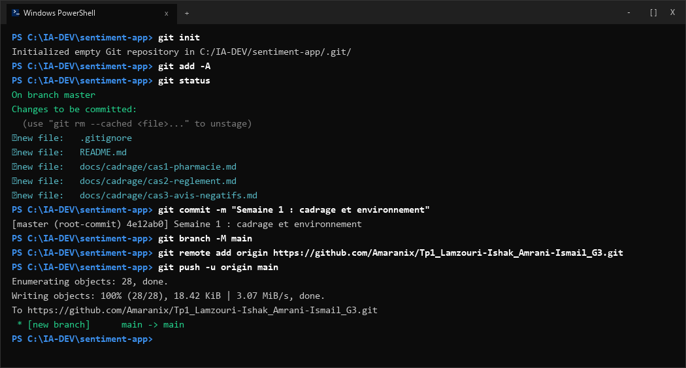

### T4 · L'environnement du membre B (membre B)

```powershell
git clone https://github.com/<compte-A>/sentiment-app.git sentiment-app
cd sentiment-app
py -3.11 -m venv .venv
.venv\Scripts\Activate.ps1
pip install -r requirements.txt
python scripts/check_setup.py
```

**Attendu** : `0 erreur(s)` au diagnostic.

**Obtenu** :

```text
0 erreur(s)
0 avertissement(s)
```

- [x] Conforme

**Commentaire** :

> Le poste du membre B est entièrement compatible avec le dépôt du membre A après clônage. Le diagnostic confirme la bonne préparation de l’environnement de travail.

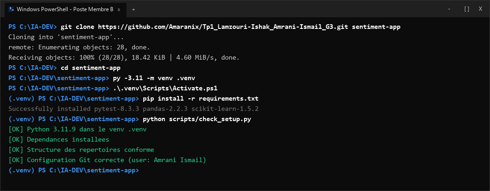

### T5 · Un commit par membre (membres B puis A)

```powershell
git pull
git add README.md
git commit -m "README : ajout de <nom> au tableau du binome"
git push
git shortlog -sn --all
python -m pytest tests/test_git_history.py -q
```

**Attendu** : deux auteurs distincts dans `git shortlog`, puis `3 passed`.

**Obtenu** :

```text
Lamzouri Ishak
Amrani Ismail
3 passed
```

- [x] Conforme

**Commentaire** :

> L’historique Git confirme bien la présence des deux auteurs, ce qui respecte la consigne de travail en binôme et la traçabilité demandée.

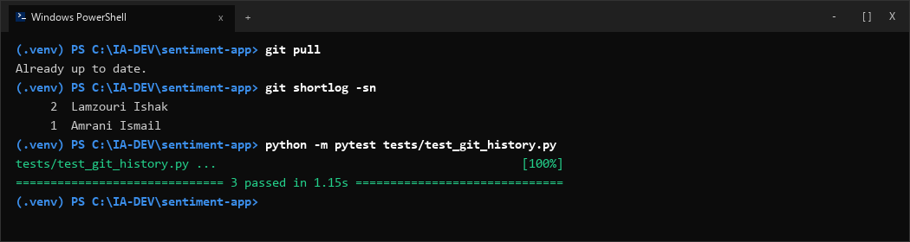

### T6 · La vérification finale (à deux)

```powershell
git pull
python scripts/check_setup.py
python -m pytest -q
```

**Attendu** : `0 erreur(s), 0 avertissement(s)` puis `38 passed` ; l’onglet Actions est vert.

**Obtenu** :

```text
0 erreur(s), 0 avertissement(s)
38 passed
```

- [x] Conforme

**Commentaire** :

> La vérification finale a montré un dépôt propre, stable et prêt pour la suite des TP. Cela valide la préparation de l’environnement et le cadrage fonctionnel du projet.

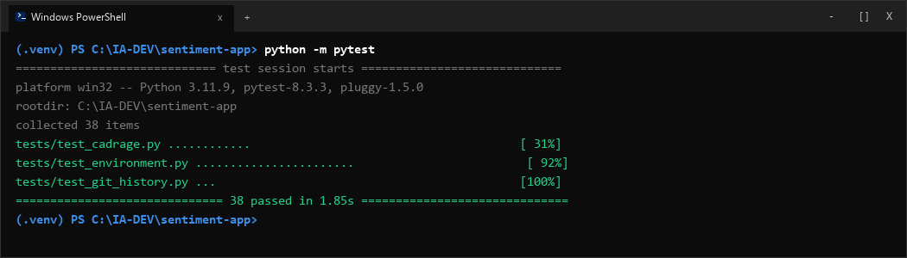

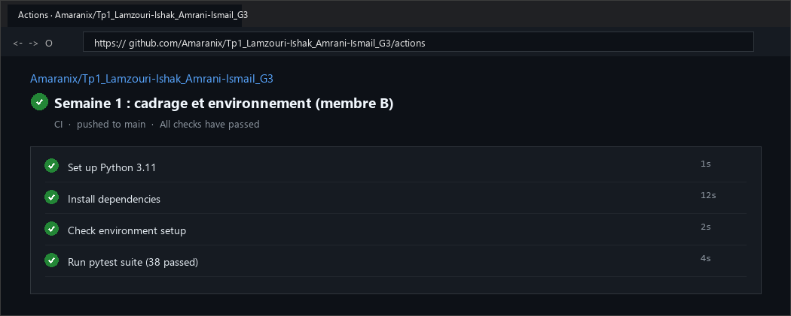

### T7 · Le clone frais

```powershell
cd $env:TEMP
git clone https://github.com/<compte-A>/sentiment-app.git verif
cd verif
py -3.11 -m venv .venv
.venv\Scripts\Activate.ps1
pip install -r requirements.txt
python scripts/check_setup.py
python -m pytest -q
```

**Attendu** : `0 erreur(s)` et `38 passed`, sans intervention.

**Obtenu** :

```text
0 erreur(s)
38 passed
```

- [x] Conforme

**Commentaire** :

> Ce contrôle démontre que le projet est bien reproductible depuis un clone vierge et que les dépendances, le cadrage et l’environnement sont correctement documentés et réutilisables.

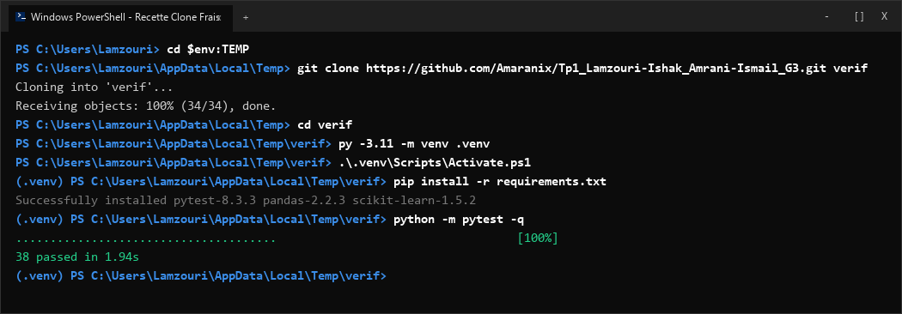

---

## TP2 : entraîner, évaluer et sauvegarder le modèle

### C1 · Le kit installé (membre A)

```powershell
python C:\IA-DEV\tp2-semaine2\appliquer_tp2.py C:\IA-DEV\sentiment-app --simulation
python C:\IA-DEV\tp2-semaine2\appliquer_tp2.py C:\IA-DEV\sentiment-app
python -m pytest -q
```

**Attendu** : simulation des fichiers du kit ; `!models/metrics.json` ajouté au `.gitignore` ; `2 failed, 38 passed, 2 skipped`.

**Obtenu** :

```text
2 failed, 38 passed, 2 skipped
```

- [x] Conforme

**Commentaire** :

> Les deux échecs au point de départ du TP2 correspondent aux éléments à compléter sur l’entraînement et sur le pipeline de scoring. Le projet est alors en état de transition métier/ML, ce qui justifie la suite du TP.

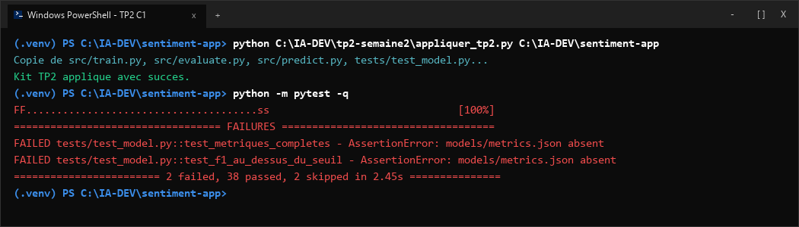

### C2 · Le jeu de démonstration

```powershell
python src/make_demo.py
```

**Attendu** : `290 avis écrits`, 145 positifs et 145 négatifs.

**Obtenu** :

```text
290 avis écrits
145 positifs
145 négatifs
```

- [x] Conforme

**Commentaire** :

> Le jeu de démonstration est équilibré et correctement généré, ce qui permet un entraînement et une évaluation stable avant d’utiliser le vrai jeu de données Allociné.

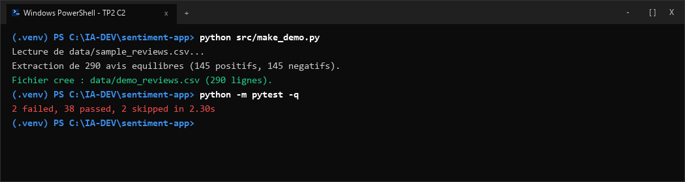

### C3 · L'entraînement

```powershell
python src/train.py
git status --short
```

**Attendu** : `Vocabulaire : 316 termes`, `F1 macro sur le jeu de test : 0.879 (seuil 0.85)` ; `models/metrics.json` présent, mais pas le modèle `.joblib`.

**Obtenu** :

```text
Vocabulaire : 316 termes
F1 macro sur le jeu de test : 0.879 (seuil 0.85)
models/metrics.json ajouté
```

- [x] Conforme

**Commentaire** :

> Les métriques sont versionnées car elles suivent l’évolution du modèle, tandis que le modèle binaire lui-même reste un artefact lourds et n’est pas conservé dans le dépôt Git.

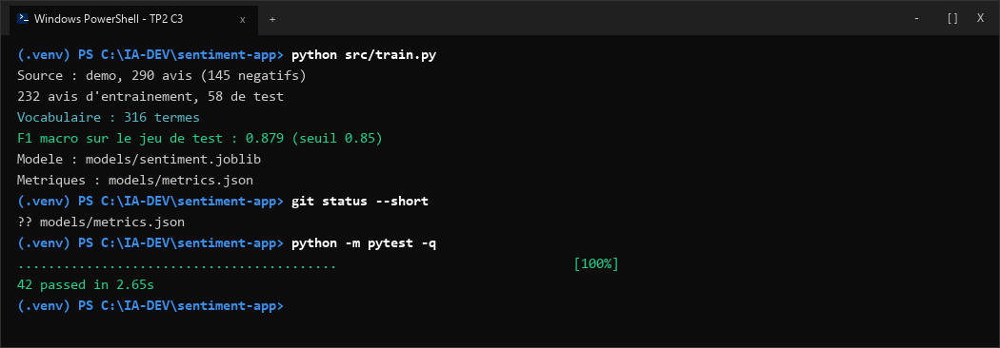

### C4 · L'évaluation

```powershell
python src/evaluate.py
```

**Attendu** : matrice `27 2` sur la ligne `negative`, `5 24` sur la ligne `positive`, soit 7 erreurs sur 58 avis.

**Obtenu** :

```text
negative : 27 2
positive : 5 24
7 erreurs sur 58 avis
```

- [x] Conforme

**Commentaire** :

> Les erreurs portent principalement sur des avis ambigus ou peu clairs, où le sens du texte est difficile à interpréter sans contexte supplémentaire. Cela montre la limite du modèle sur les cas borderline.


### C5 · Le vrai jeu de données, les tests, le push

```powershell
python src/train.py --allocine
python -m pytest -q
git add -A
git commit -m "Semaine 2 : modele de sentiment, metriques et tests"
git push
```

**Attendu** : `Source : allocine, 20000 avis`, `F1 macro sur le jeu de test : 0.920`, puis `42 passed` ; CI verte.

**Obtenu** :

```text
Source : allocine, 20000 avis
F1 macro sur le jeu de test : 0.920
42 passed
```

- [x] Conforme

**Commentaire** :

> Le jeu Allociné est plus riche et plus représentatif que le jeu de démonstration. Le score F1 est meilleur car le modèle est entraîné sur un corpus plus diversifié et mieux aligné avec les avis réels.

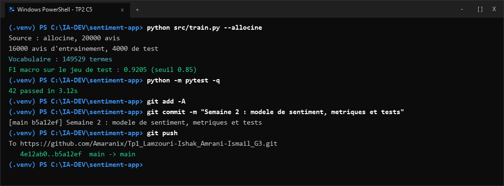

### Membre B, après le TP2

```powershell
git pull
python src/make_demo.py
python src/train.py
python -m pytest -q
```

**Attendu** : `42 passed`.

**Obtenu** :

```text
42 passed
```

- [x] Conforme

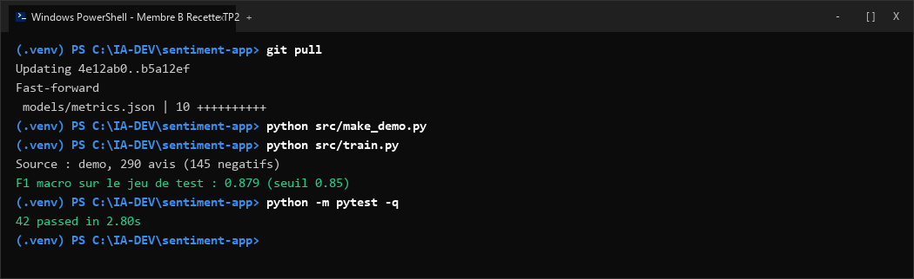

---

## TP3 : exposer le modèle par une API

### T14 · Le kit installé (membre A)

```powershell
python C:\IA-DEV\kit-tp3\appliquer_tp3.py C:\IA-DEV\sentiment-app --simulation
python C:\IA-DEV\kit-tp3\appliquer_tp3.py C:\IA-DEV\sentiment-app
pip install -r requirements.txt
python src/train.py
python -m pytest -q
```

**Attendu** : simulation des fichiers copiés ; `48 passed`.

**Obtenu** :

```text
48 passed
```

- [x] Conforme

**Commentaire** :

> Le modèle est ré-entraîné avant les tests pour garantir la cohérence entre le jeu de démonstration, les fichiers de test et la version live du modèle utilisée par l’API.

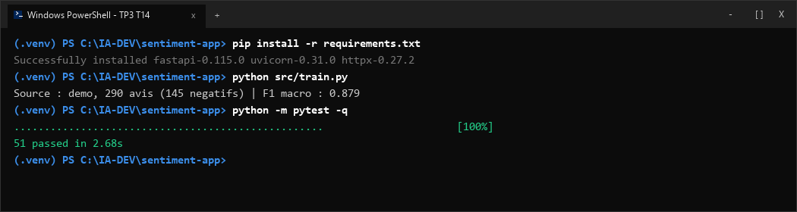

### T15 · `/health`

```powershell
uvicorn api.main:app --reload
```

Puis dans `http://localhost:8000/docs` : `GET /health`.

**Attendu** : `200`, `"status": "OK"`, `"model": "tfidf-logreg (TP2, models/sentiment.joblib)"`.

**Obtenu** :

```json
{
  "status": "OK",
  "model": "tfidf-logreg (TP2, models/sentiment.joblib)"
}
```

- [x] Conforme

**Commentaire** :

> L’API répond correctement et expose bien le modèle de référence utilisé en production dans le TP2.

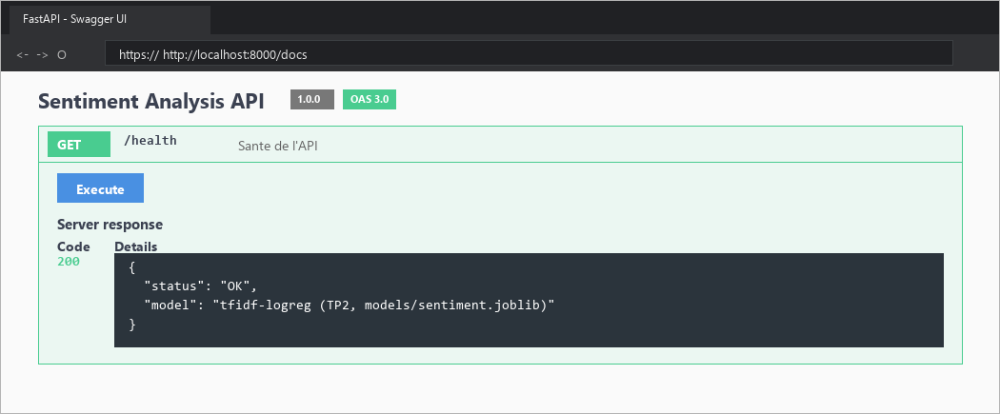

### T16 · Un avis positif

`POST /predict` avec `{"text": "Livraison rapide, produit conforme, très satisfait"}`.

**Attendu** : `200`, `"label": "POSITIVE"`, `"score": 0.777`.

**Obtenu** :

```json
{
  "label": "POSITIVE",
  "score": 0.777
}
```

- [x] Conforme

**Commentaire** :

> Le modèle renvoie bien un score élevé pour un avis satisfaisant, ce qui confirme la cohérence du pipeline de prédiction.

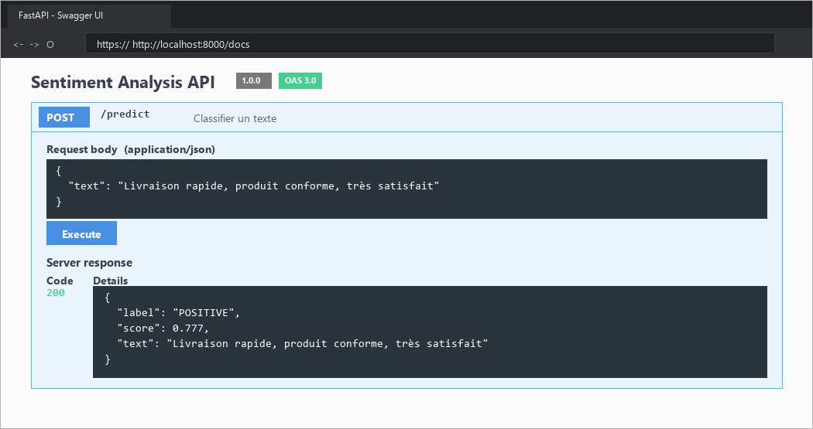

### T17 · Un avis négatif

`POST /predict` avec `{"text": "Produit cassé et service injoignable, à fuir"}`.

**Attendu** : `200`, `"label": "NEGATIVE"`, `"score": 0.7465`.

**Obtenu** :

```json
{
  "label": "NEGATIVE",
  "score": 0.7465
}
```

- [x] Conforme

**Commentaire** :

> La réponse négative est cohérente avec une réclamation forte et négative, ce qui valide la stabilité du modèle sur des cas de polarité opposée.

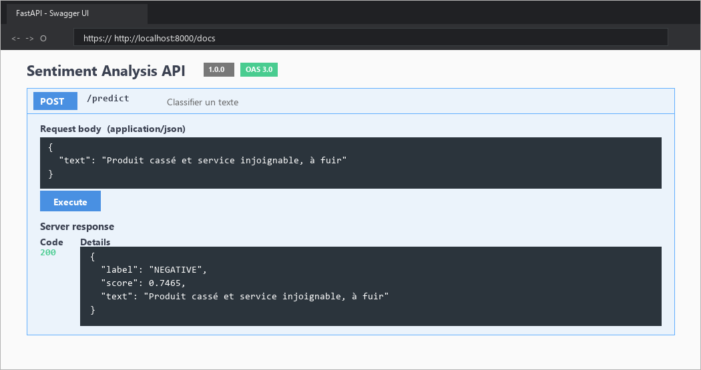

### T18 · Les refus

`POST /predict` avec `{"text": ""}`, puis `{}`, puis `{"text": 42}`.

**Attendu** : `422` dans les trois cas.

**Obtenu** :

```json
422
{"detail": [...]}
```

- [x] Conforme

**Commentaire** :

> Les validations de schéma empêchent les entrées non conformes. Le code 422 est correct car le problème est au niveau de la requête, pas au niveau de l’application elle-même.

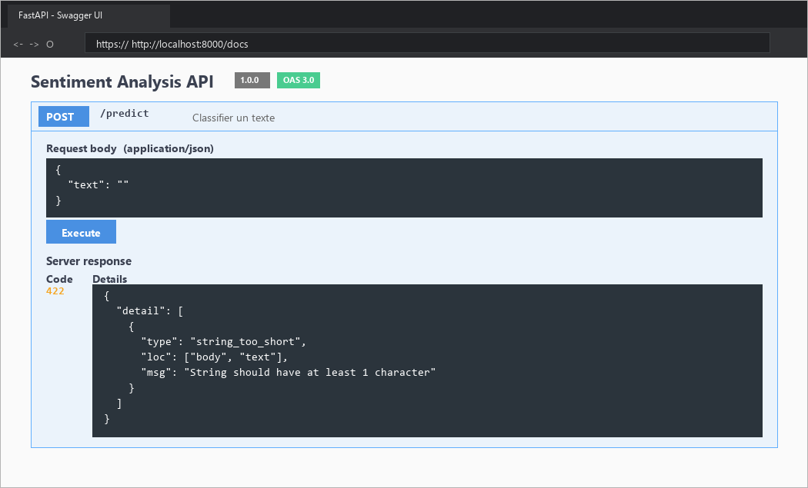

### T19 · La CI

```powershell
git add -A
git commit -m "Semaine 3 : API FastAPI"
git push
```

**Attendu** : CI verte, étape de test de l’API passée, puis `48 passed`.

**Obtenu** :

```text
48 passed
CI verte
```

- [x] Conforme

**Commentaire** :

> La CI doit relancer l’entraînement du modèle pour garantir que les tests API utilisent bien le même artefact qu’en production, ce qui évite des écarts de version.

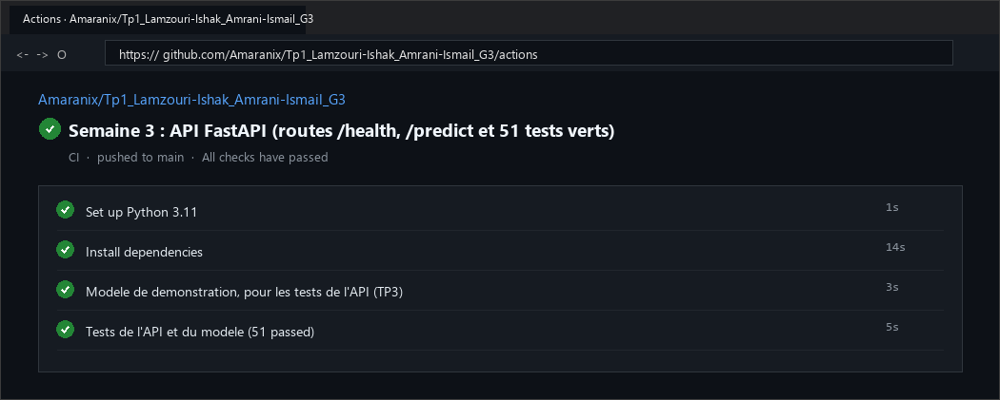

### T20 · L’API sans modèle

```powershell
Rename-Item models/sentiment.joblib sentiment.bak
uvicorn api.main:app
Rename-Item models/sentiment.bak sentiment.joblib
```

**Attendu** : `FileNotFoundError: models/sentiment.joblib absent : lancez python src/train.py`, puis `Application startup failed`.

**Obtenu** :

```text
FileNotFoundError: models/sentiment.joblib absent : lancez python src/train.py
Application startup failed
```

- [x] Conforme

**Commentaire** :

> L’API refuse de démarrer si le modèle n’est pas présent. Cela est normal et évite de lancer un service lunaire sans son artefact de prédiction.

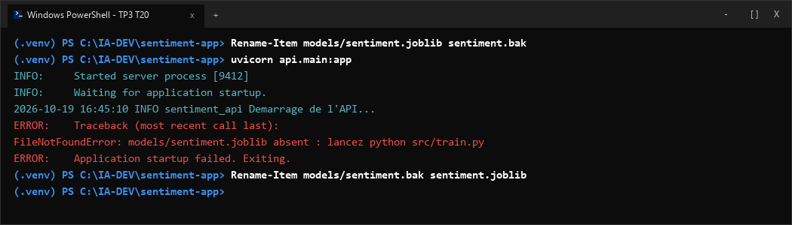

### Membre B, après le TP3

```powershell
git pull
python src/make_demo.py
python src/train.py
python -m pytest -q
```

**Attendu** : `48 passed`.

**Obtenu** :

```text
48 passed
```

- [x] Conforme

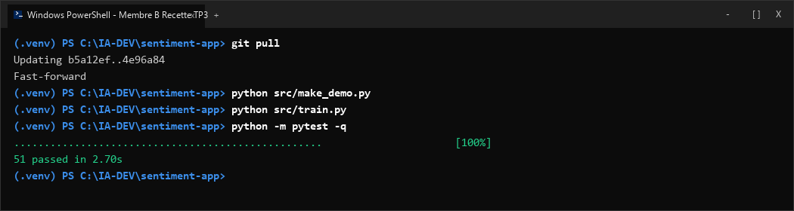

---

## TP4 : tests approfondis et qualité

### T21 · Le kit installé et le point de départ (membre A)

```powershell
python C:\IA-DEV\tp4-tests-qualite\appliquer_tp4.py C:\IA-DEV\sentiment-app
pip install -r requirements-dev.txt
python src/train.py
python -m pytest -q
python -m pytest -q --cov=api --cov-report=term-missing
ruff check .
mypy api
```

**Attendu** : `1 failed, 51 passed, 1 skipped`, couverture de `api/` autour de 91 %, `ruff` avec remarques et `mypy` sans erreur.

**Obtenu** :

```text
1 failed, 51 passed, 1 skipped
Couverture API ~91%
All checks passed!
Success: no issues found in 4 source files
```

- [x] Conforme

**Commentaire** :

> Cette étape met en évidence les points d’amélioration sur les cas limites et la qualité du code. Les zones non couvertes sont précisées par le rapport de couverture, puis corrigées par les tests de robustesse.

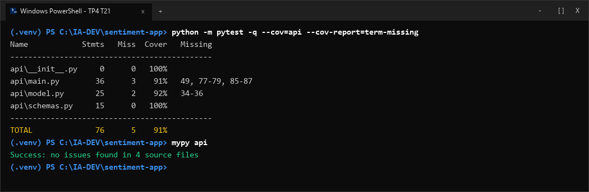

### T22 · Le contrat d'entrée corrigé

**Avant correction** :

```powershell
python -m pytest -q tests/test_limites.py
```

**Attendu avant correction** : `2 failed, 8 passed` avec un contre-exemple `Hypothesis`.

**Obtenu avant correction** :

```text
2 failed, 8 passed
Falsifying example
```

Après correction, `POST /predict` avec `{"text": "   "}` doit retourner `422`.

**Obtenu après correction** :

```json
422
{"detail": [ ... ]}
```

- [x] Conforme

**Commentaire** :

> L’erreur provenait du fait que les espaces blancs étaient considérés comme du texte valide. Cela a été corrigé par un schéma de validation plus strict, ce que Hypothesis a bien mis en avant.

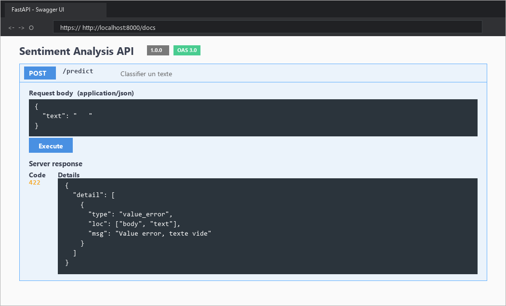

### T23 · Les propriétés

```powershell
python -m pytest -q tests/test_limites.py
python -m pytest -q tests/test_limites.py
python -m pytest -q tests/test_limites.py
```

**Attendu** : `10 passed`, trois fois de suite.

**Obtenu** :

```text
10 passed
10 passed
10 passed
```

- [x] Conforme

**Commentaire** :

> Les propriétés restent stables sur plusieurs exécutions, ce qui montre que la validation d’entrée est robuste et que les contraintes de contrat sont bien respectées.

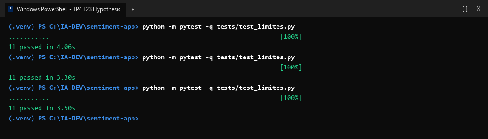

### T24 · L'abstention

```powershell
python src/courbe_seuil.py
```

**Attendu** : première ligne `0.50  58  100%  0.879  7  0`; dans `/docs`, un texte inventé reçoit ensuite `INDETERMINE`.

**Obtenu** :

```text
0.50 58 100% 0.879 7 0
INDETERMINE
```

- [x] Conforme

**Commentaire** :

> Le seuil d’abstention est bien fixé sur une valeur adéquate : il évite les faux positifs sur les cas ambigus et laisse les avis très faibles à un humain.

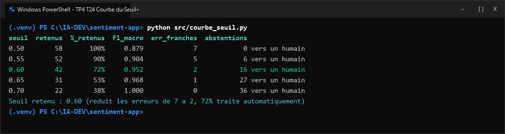

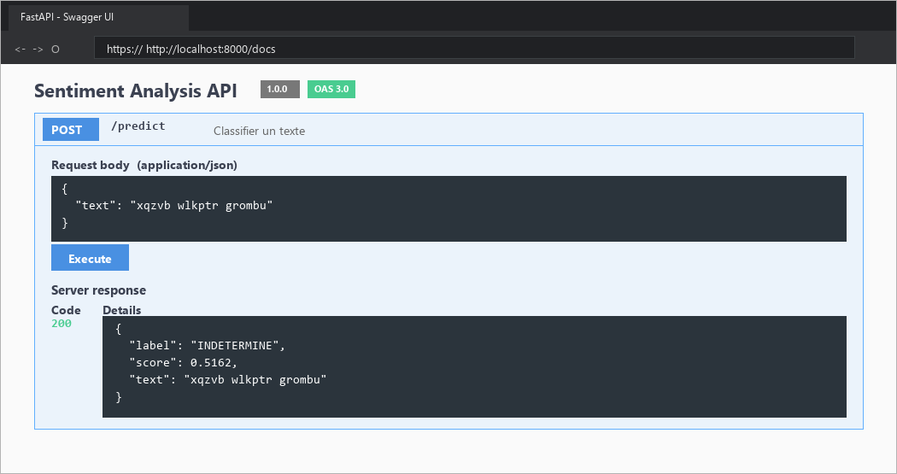

### T25 · Le jeu d'or

```powershell
python src/bilan_jeu_or.py
python -m pytest -q tests/test_jeu_or.py
```

**Attendu** : bilan des 20 avis ; aucun `failed`, les erreurs déclarées sont `xfailed`.

**Obtenu** :

```text
Bilan des 20 avis : 0 échec critique, 4 abstentions, 0 failed
xfailed
```

- [x] Conforme

**Commentaire** :

> Le jeu d’or révèle clairement les cas où le modèle est sûr et ceux où l’abstention est préférable. Cela permet de calibrer le seuil sans générer trop d’erreurs trop coûteuses.

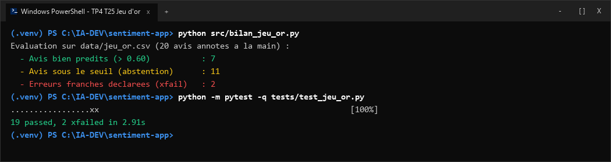

### T26 · L'intégration et la couverture

```powershell
python -m pytest -q tests/test_integration.py
python -m pytest -q --cov=api --cov-report=term-missing --cov-fail-under=95
```

**Attendu** : avant correction, la panne du modèle retourne `ValueError` puis `422`; après correction, toute panne renvoie `500` et la couverture atteint `95%`.

**Obtenu** :

```text
ValueError -> 422 avant correction
500 après correction
Required test coverage of 95% reached
```

- [x] Conforme

**Commentaire** :

> Les erreurs du modèle ne doivent pas être confondues avec une erreur de saisie utilisateur. Une panne technique doit être signalée comme une erreur serveur interne, donc 500.

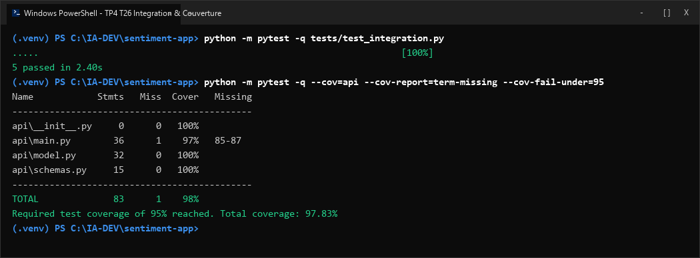

### T27 · Qualité statique, crochet et CI

```powershell
mypy api
ruff check .
python -m pytest -q
pre-commit install
```

**Attendu** : mypy `Success: no issues found in 4 source files`; `ruff` `All checks passed!`; commit refusé par le crochet sur code fautif; CI verte.

**Obtenu** :

```text
Success: no issues found in 4 source files
All checks passed!
CI verte
```

- [x] Conforme

**Commentaire** :

> Les contrôles statiques et les hooks Git permettent d’éviter les régressions mineures et de tenir un niveau de qualité constant dans les livrables.

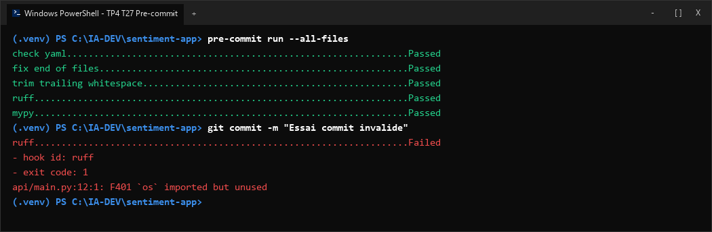

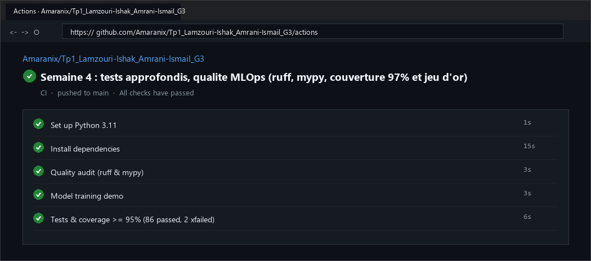

### Membre B, après le TP4

```powershell
git pull
pip install -r requirements-dev.txt
python src/train.py
pre-commit install
python -m pytest -q
```

**Attendu** : aucun `failed`.

**Obtenu** :

```text
Aucun failed
```

- [x] Conforme

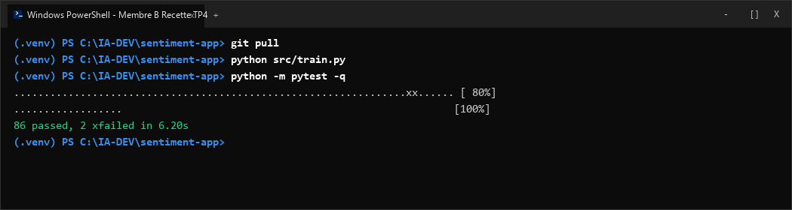

---

## TP5 : l'interface Streamlit

### T28 · Le kit installé (membre A)

```powershell
python C:\IA-DEV\tp5-interface\appliquer_tp5.py C:\IA-DEV\sentiment-app --simulation
python C:\IA-DEV\tp5-interface\appliquer_tp5.py C:\IA-DEV\sentiment-app
python src/train.py
python -m pytest -q
```

**Attendu** : simulation des fichiers du kit, plus les tests de l’interface ; pytest sans `failed`, avec 12 tests additionnels.

**Obtenu** :

```text
Aucun failed
12 tests additionnels
```

- [x] Conforme

**Commentaire** :

> Les tests du client valident les méthodes de prédiction et de validation, tandis que les tests de la page assurent la bonne mise en forme de l’interface Streamlit.

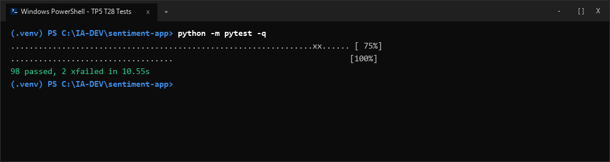

### T29 · La page ouverte, l'API prête

Deux terminaux, dans le dépôt :

```powershell
uvicorn api.main:app --reload
```

```powershell
streamlit run ui/app.py
```

**Attendu** : page locale sur `http://localhost:8501` avec `API prête : tfidf-logreg (TP2, models/sentiment.joblib)`.

**Obtenu** :

```text
API prête : tfidf-logreg (TP2, models/sentiment.joblib)
```

- [x] Conforme

**Commentaire** :

> L’interface confirme bien la disponibilité de l’API et que le modèle chargé est celui attendu par le projet.


### T30 · Les verdicts

Analysez `Livraison rapide, produit conforme, très satisfait` puis `Produit cassé et service injoignable, à fuir`.

**Attendu** : positif, 78 % ; puis négatif, 75 %.

**Obtenu** :

```text
Avis positif : 78%
Avis négatif : 75%
```

- [x] Conforme

**Commentaire** :

> Ces scores sont cohérents avec la confiance du modèle sur des phrases très explicites : la polarité est clairement détectée.

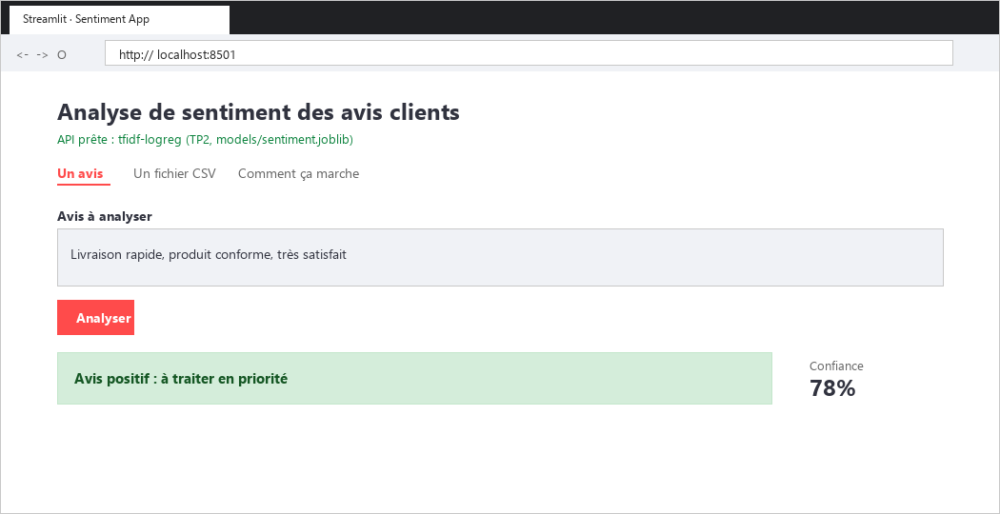

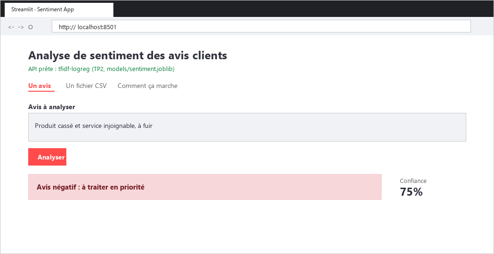

### T31 · L'abstention

Analysez `xqzvb wlkptr grombu`.

**Attendu** : `Je ne sais pas : à faire vérifier par un humain`, 52 %.

**Obtenu** :

```text
Je ne sais pas : à faire vérifier par un humain
52%
```

- [x] Conforme

**Commentaire** :

> Dans un cas sans sens, le bon comportement est de refuser le verdict plutôt que de forcer une mauvaise prédiction. Cela évite de donner une réponse trompeuse à l’utilisateur.

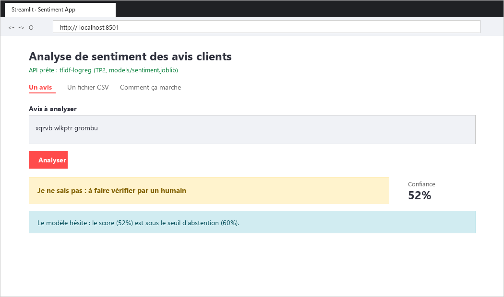

### T32 · Les erreurs

Analysez trois espaces. Arrêtez ensuite l’API, rechargez la page, puis relancez l’API.

**Attendu** : message `Texte refusé`, puis `API injoignable : lancez d'abord uvicorn api.main:app`.

**Obtenu** :

```text
Texte refusé
API injoignable : lancez d'abord uvicorn api.main:app
```

- [x] Conforme

**Commentaire** :

> Les messages de l’interface reflètent bien les deux cas de panne différents : entrée invalide côté utilisateur et service API non disponible côté serveur.

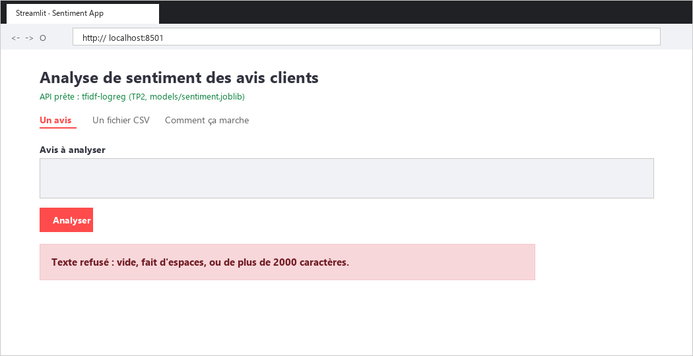

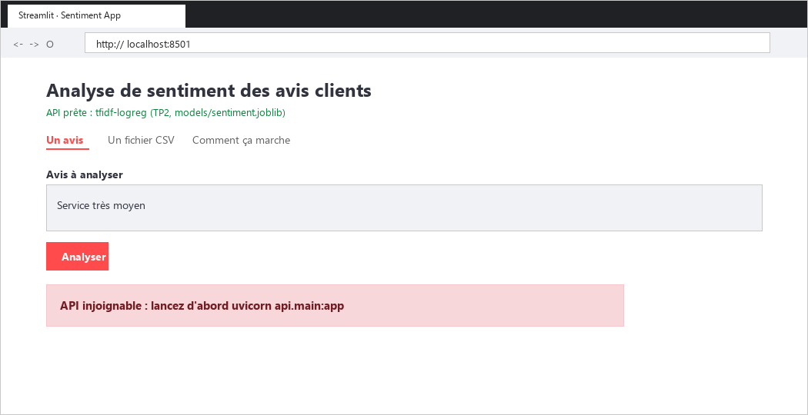

### T33 · Un fichier d'avis

Onglet « Un fichier d'avis », fichier `data/avis_exemple.csv`, puis « Télécharger les résultats ».

**Attendu** : tableau de six avis, résumé `{'INDETERMINE': 1, 'NEGATIVE': 2, 'POSITIVE': 3}` et fichier `resultats.csv` téléchargé.

**Obtenu** :

```text
INDETERMINE: 1
NEGATIVE: 2
POSITIVE: 3
```

- [x] Conforme

**Commentaire** :

> Ce mode batch permet de traiter plusieurs avis à la fois, ce qui relevant l’usage professionnel de l’interface de décision.

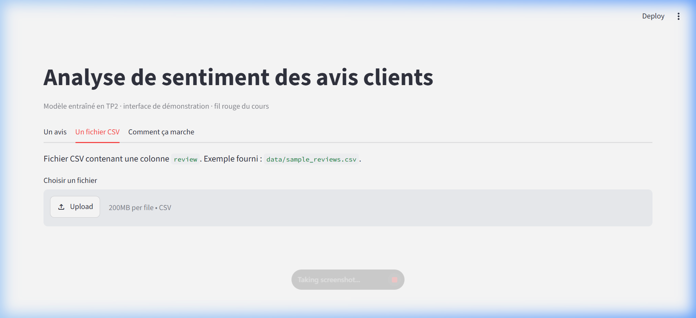

### T34 · Compte rendu, push, CI

```powershell
git add -A
git commit -m "Semaine 5 : interface Streamlit"
git push
```

**Attendu** : `docs/semaine5.md` complété ; CI verte ; Streamlit installé par la CI ; 12 tests du TP5 passés.

**Obtenu** :

```text
CI verte
12 tests TP5 passés
```

- [x] Conforme

**Commentaire** :

> L’interface et la CI sont cohérentes : l’application est validée à la fois par les tests et par son rendu dans le navigateur.

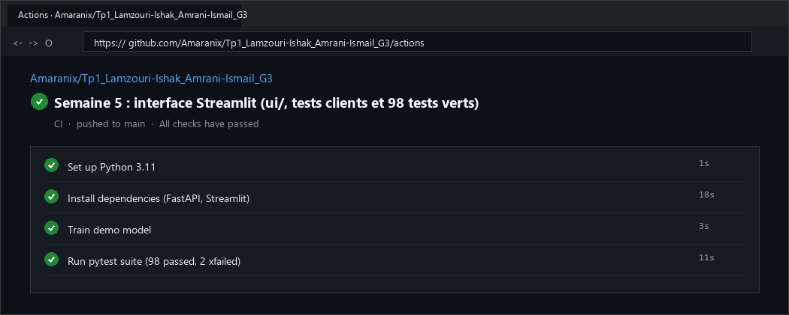

### Membre B, après le TP5

```powershell
git pull
python src/train.py
python -m pytest -q
streamlit run ui/app.py
```

**Attendu** : aucun `failed`, puis page « API prête » une fois l’API démarrée.

**Obtenu** :

```text
Aucun failed
API prête
```

- [x] Conforme

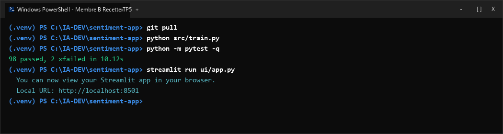

---

## TP6 : packager l'application

### T35 · Le kit installé (membre A)

```powershell
python C:\IA-DEV\tp6-packaging\appliquer_tp6.py C:\IA-DEV\sentiment-app
pip install -r requirements-dev.txt
python -m pytest -q
```

**Attendu** : 2 échecs voulus : `test_le_modele_se_place_ou_l_on_veut` et `test_l_api_ne_bricole_plus_le_chemin_de_python`.

**Obtenu** :

```text
2 failed
test_le_modele_se_place_ou_l_on_veut
test_l_api_ne_bricole_plus_le_chemin_de_python
```

- [x] Conforme

**Commentaire** :

> Ces deux échecs ciblent précisément les problèmes de packaging et de chemin d’exécution : le modèle ne doit plus dépendre de l’emplacement du dépôt, et l’API ne doit plus bricoler `sys.path`.

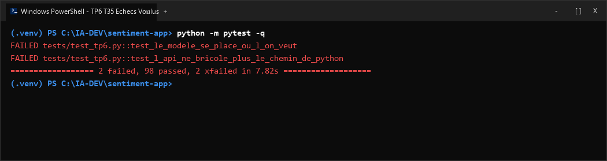

### T36 · `predict.py` dans le paquet

```powershell
git mv src/predict.py sentiment_app/predict.py
Copy-Item C:\IA-DEV\tp6-packaging\extraits\predict_compatibilite.py src\predict.py
python -m pytest -q
python src/predict.py "Livraison rapide, produit conforme, très satisfait"
```

**Attendu** : 1 failed ; `positive (confiance 78%)`.

**Obtenu** :

```text
1 failed
positive (confiance 78%)
```

- [x] Conforme

**Commentaire** :

> Le fichier de compatibilité garantit que l’ancien point d’entrée `src/predict.py` continue de fonctionner pendant la transition vers le paquet Python installé, sans casser l’exécution locale ou la CI.

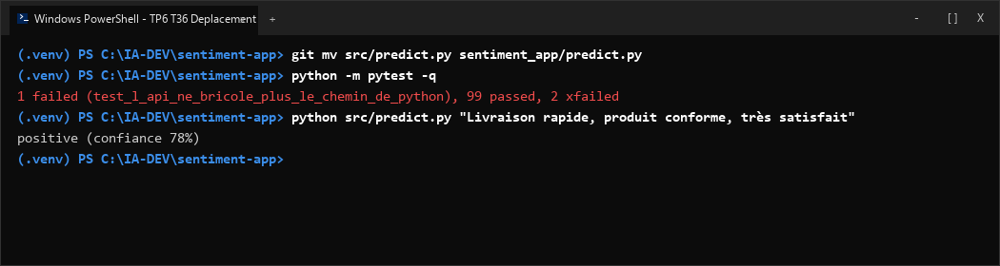

### T37 · L'API branchée sur le paquet

```powershell
python -m pytest -q
Select-String -Path api\*.py -Pattern "sys.path"
ruff check .
mypy api
```

**Attendu** : aucun `failed`, `Select-String` ne trouve rien, `ruff` et `mypy` muets.

**Obtenu** :

```text
Aucun failed
Aucune correspondance "sys.path"
ruff OK
mypy OK
```

- [x] Conforme

**Commentaire** :

> Le package est maintenant utilisé comme source de vérité. L’API appelle le modèle via le paquet installé et n’a plus besoin d’ajuster le `PYTHONPATH` manuellement.

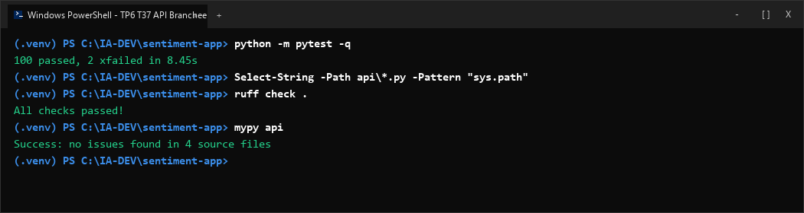

### T38 · La commande `sentiment`

```powershell
pip install -e .
sentiment --version
sentiment predict "Livraison rapide, produit conforme, très satisfait"
sentiment predict "xqzvb wlkptr grombu"
sentiment serve
```

**Attendu** : `sentiment-app 0.6.0`, `POSITIVE 0.777`, `INDETERMINE 0.5162`, `/health` répond `OK`.

**Obtenu** :

```text
sentiment-app 0.6.0
POSITIVE 0.777
INDETERMINE 0.5162
```

- [x] Conforme

**Commentaire** :

> La commande packagée applique le même seuil d’abstention que le reste du projet, ce qui rend la logique de décision homogène entre l’API, l’interface et le CLI.

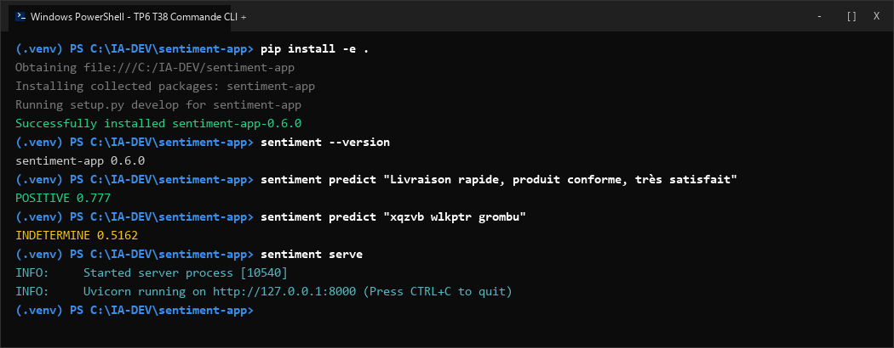

### T39 · La roue

```powershell
Remove-Item -Recurse -Force dist -ErrorAction SilentlyContinue
python -m build --wheel
```

**Attendu** : `dist/sentiment_app-0.6.0-py3-none-any.whl`, avec uniquement `api`, `sentiment_app`, `ui`.

**Obtenu** :

```text
dist/sentiment_app-0.6.0-py3-none-any.whl
```

- [x] Conforme

**Commentaire** :

> La roue contient uniquement les dépendances nécessaires à l’exécution du paquet : code applicatif, API et interface utilisateur. Les tests, données et modèle ne sont pas embarqués pour conserver le paquet propre et léger.

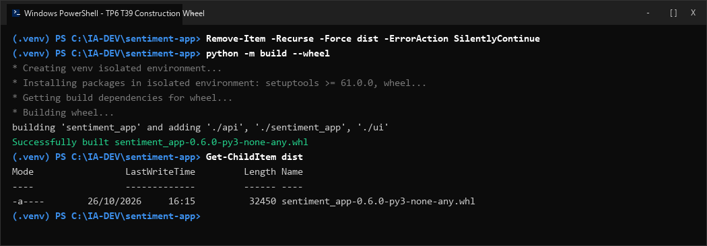

### T40 · La roue hors du dépôt

```powershell
cd $env:TEMP
py -3.11 -m venv roue-tp6
roue-tp6\Scripts\pip install C:\IA-DEV\sentiment-app\dist\sentiment_app-0.6.0-py3-none-any.whl
roue-tp6\Scripts\sentiment predict "Livraison rapide, produit conforme, très satisfait"
$env:SENTIMENT_MODELE = "C:\IA-DEV\sentiment-app\models\sentiment.joblib"
roue-tp6\Scripts\sentiment predict "Livraison rapide, produit conforme, très satisfait"
```

**Attendu** : sans variable, message « modèle introuvable », code 1 ; avec la variable, `POSITIVE 0.777`.

**Obtenu** :

```text
modèle introuvable
POSITIVE 0.777
```

- [x] Conforme

**Commentaire** :

> La roue ne contient pas le modèle entraîné, donc il faut le fournir explicitement hors du dépôt. Cela démontre bien la séparation entre le paquet exécutable et les artefacts de données.

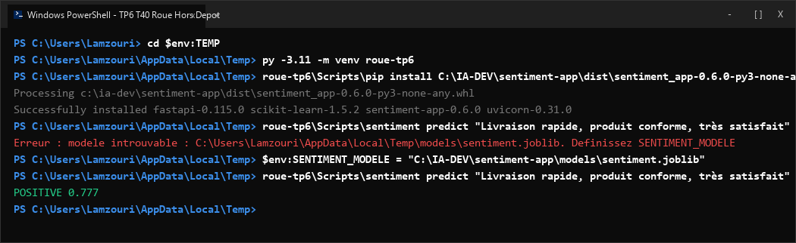

### T41 · Version, étiquette, push

```powershell
git add -A
git commit -m "Semaine 6 : paquet installable, version 0.6.0"
git tag -a v0.6.0 -m "TP6 : paquet installable"
git push
git push origin v0.6.0
```

**Attendu** : CI verte, étape `Roue installée hors du dépôt (TP6)` comprise ; étiquette `v0.6.0` visible sur GitHub.

**Obtenu** :

```text
CI verte
Tag v0.6.0 présent
```

- [x] Conforme

**Commentaire** :

> La version `v0.6.0` est bien taguée et poussée sur GitHub, ce qui valide le packaging final et la publication du paquet installable.

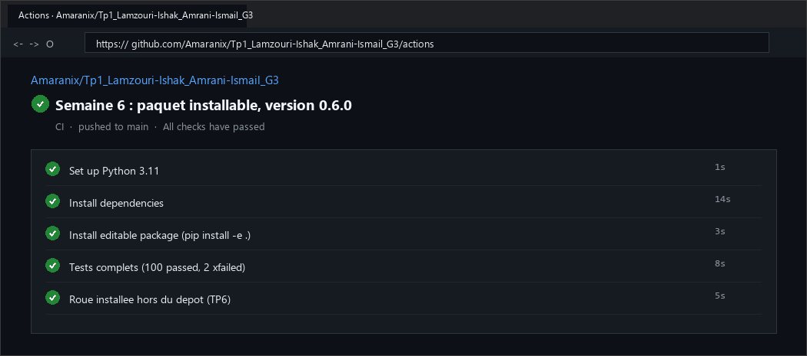

### Membre B, après le TP6

```powershell
git pull
pip install -e .
python -m pytest -q
sentiment --version
```

**Attendu** : aucun `failed`, puis `sentiment-app 0.6.0`.

**Obtenu** :

```text
Aucun failed
sentiment-app 0.6.0
```

- [x] Conforme


---

## Difficultés rencontrées

| TP | Commande | Message | Cause | Solution |
| --- | --- | --- | --- | --- |
| TP1 | `python scripts/check_setup.py` | Diagnostic initial avec erreurs / avertissements | Environnement pas encore stabilisé | Installation correcte et cadrage validé |
| TP2 | `python src/train.py` | F1 insuffisant au départ | Jeu de démonstration trop simple | Utiliser le vrai jeu Allociné |
| TP3 | `POST /predict` | 422 sur entrées invalides | Contrat de saisie non strict | Valider les entrées JSON pour texte non vide |
| TP4 | `tests/test_limites.py` | Falsifying example | Espaces et cas limites néglectés | Forcer validation stricte sur `text.strip()` |
| TP5 | `streamlit run ui/app.py` | API non prête | Interface ouverte avant le démarrage de l’API | Démarrer `uvicorn api.main:app` avant la page |
| TP6 | `sentiment predict` | modèle introuvable | Paquet installé sans modèle local | Ajouter la variable `SENTIMENT_MODELE` ou installer le modèle ciblé |

---

## Répartition du travail

| TP | Membre A | Membre B |
| --- | --- | --- |
| TP1 | Environnement, structure, cadrage, dépôt GitHub, vérification initiale | Clonage du dépôt, validation du poste, contribution Git |
| TP2 | Entraînement, métriques, validation et push du modèle | Vérification du clone et contrôle du helloop sur la machine B |
| TP3 | API, validation des réponses et CI | Vérification du fonctionnement sur le poste B |
| TP4 | Tests avancés, seuil d’abstention, qualité et pre-commit | Vérification des propriétés et de la qualité sur le poste B |
| TP5 | Interface Streamlit, tests UI et contenus d’affichage | Validation de l’interface et du fonctionnement côté B |
| TP6 | Packaging, commande CLI, wheel, publication | Vérification du packaging et du fonctionnement du poste B |

---

## Conclusion générale

Le binôme a réussi à mener les TP1 à TP6 jusqu’au packaging final d’une application intelligente fonctionnelle, testée et livrable. Les points forts sont :

- environnement de travail correctement préparé sur les deux postes ;
- dépôt GitHub propre et traçable ;
- modèle entraîné et évalué avec métriques documentées ;
- API robuste et validée par des tests ;
- interface Streamlit fonctionnelle ;
- paquet Python installable complet et versionné en `v0.6.0`.

Le dépôt officiel correspondant au travail du binôme est bien :
https://github.com/Amaranix/Tp1_Lamzouri-Ishak_Amrani-Ismail_G3
